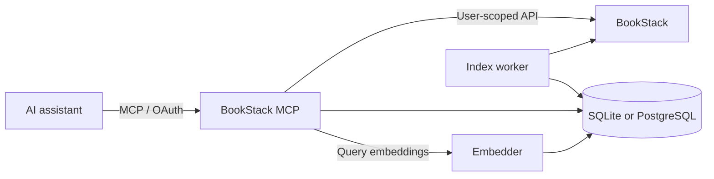

<div align="center">

# BookStack MCP

### Your knowledge. Your AI. Your infrastructure.

Connect your self-hosted [BookStack](https://www.bookstackapp.com/) knowledge base to AI assistants through the Model Context Protocol.

[](Cargo.toml)
[](https://github.com/drbelt27/bookstack-mcp/actions/workflows/build-main.yml)
[](LICENSE)
[](https://www.rust-lang.org/)
[](https://github.com/drbelt27/bookstack-mcp/stargazers)
[](#setup)
[](https://modelcontextprotocol.io/)

**[Quick start](#setup) · [Documentation](#documentation) · [Changelog](CHANGELOG.md) · [Releases](https://github.com/drbelt27/bookstack-mcp/releases) · [Report an issue](https://github.com/drbelt27/bookstack-mcp/issues)**

[](https://ko-fi.com/U5R22ATDML)

</div>

---

## Bring your documentation into the AI workflow

Find answers in your existing knowledge base, write and maintain documentation, and work with images and attachments — from an MCP-compatible assistant such as ChatGPT or Claude.

| Capability | What it means for your team |
|---|---|
| Natural-language discovery | Find relevant pages using optional hybrid semantic and keyword search, even when you do not know the exact wording. |
| Documentation workflows | Create, edit, organize and export knowledge-base content directly through MCP tools. |
| Individual access | Connect using per-user BookStack credentials and OAuth, with access checks on search results. |
| Local embeddings | Run semantic indexing with local ONNX models; external embedding providers are optional. |
| Flexible self-hosting | Choose SQLite or PostgreSQL with pgvector, and deploy using Docker on amd64 or arm64. |

> **Example requests**
>
> - Find the procedure for restoring access when an employee forgets their password.
> - Create an onboarding guide in our IT documentation book.
> - Summarize the relevant maintenance procedures and link to their source pages.
> - Update this page with a new section and an image hosted at an accessible public URL.

## How it works



Semantic search is optional. Local embedding inference can run without an external embedding API. If you connect a cloud AI assistant, the content returned to that assistant is subject to its own data handling policies.

Built in Rust with Tokio and Axum as a Cargo workspace with pluggable database backends.

## Features

- **59 core tools** for search, shelves, books, chapters, pages, images, attachments, permissions and more.
- **Optional semantic search:** local or external embeddings, hybrid retrieval and optional cross-encoder reranking.
- **Multi-user OAuth 2.1:** individual API credentials, encrypted token storage and access checks on semantic results.
- **Self-hosted:** SQLite or PostgreSQL with pgvector; Docker images for amd64 and arm64.
- **MCP transports:** SSE and Streamable HTTP.

See the [complete feature and architecture reference](docs/ARCHITECTURE.md).

## Setup

### Prerequisites

- A BookStack instance with API access enabled
- A BookStack API token (created in your BookStack user profile under "API Tokens")
- Docker and Docker Compose (for container deployment)

### Quick Start (PostgreSQL — recommended)

```bash
cp .env.example .env
# Edit .env with your BookStack URL, encryption key, and database password

docker compose -f docker/docker-compose.yml up -d
```

This starts four containers:
- **bsmcp-postgres** — PostgreSQL 17 with pgvector extension
- **bsmcp-server** — MCP server (port 8080)
- **bsmcp-embedder** — Background embedding service (`--role=embedder`, default); also serves `/rerank` when a reranker is configured
- **bsmcp-worker** — Reconciliation worker (same image as the embedder, started with `--role=worker`): initial walk on cold start, webhook + cron job consumption, periodic delta walk

### Quick Start (SQLite — simple)

```bash
cp .env.example .env
# Edit .env with your BookStack URL and encryption key

docker compose -f docker/docker-compose.sqlite.yml up -d
```

This starts three containers (server + embedder + worker) sharing a SQLite database file.

For full setup and connection instructions, see [Installation](docs/INSTALLATION.md) and [Configuration](docs/CONFIGURATION.md). Use a reachable HTTPS endpoint and keep credentials private. Review image tags before deployment.

## Documentation

| Guide | Contents |
|---|---|
| [Installation](docs/INSTALLATION.md) | Deployment, native binaries, client connection |
| [Configuration](docs/CONFIGURATION.md) | Environment variables, semantic search and providers |
| [Operations](docs/OPERATIONS.md) | Webhook through the proxy, backup and restore, smoke test |
| [MCP tools](docs/TOOLS.md) | Tool catalog, API endpoints, search and uploads |
| [Architecture](docs/ARCHITECTURE.md) | Features and components |
| [Migration guide](docs/MIGRATION.md) | Upgrade steps and historical breaking changes |
| [Changelog](CHANGELOG.md) | Version history and changes |
| [Security](SECURITY.md) | Security policy and reporting |
| [Development](DEVELOPMENT.md) | Build, tests and contribution workflow |

## Releases and packages

Current development version: **0.14.2**. No versioned GitHub Release has been published yet. See [build status](https://github.com/drbelt27/bookstack-mcp/actions/workflows/build-main.yml) for the rolling development stream.

- [GitHub Releases](https://github.com/drbelt27/bookstack-mcp/releases) — versioned releases and native server archives when published.
- [Server container](https://github.com/drbelt27/bookstack-mcp/pkgs/container/bsmcp-server) and [embedder container](https://github.com/drbelt27/bookstack-mcp/pkgs/container/bsmcp-embedder) — GHCR images.
- The rolling `:dev` images track development on `main`; versioned images and `:latest` are published by the release workflow. Check availability before selecting a tag. The current workspace version is not necessarily a published release.

## Development

See [DEVELOPMENT.md](DEVELOPMENT.md) for build instructions, branching model, CI/CD (artifact-before-merge), versioning, and the workflow for adding new tools.

## Support the project

If BookStack MCP helps you get more out of your knowledge base, consider supporting its continued development on Ko-fi. Contributions are entirely optional — starring the repository, reporting issues and sharing feedback are also great ways to help.

[](https://ko-fi.com/U5R22ATDML)

## License

MIT
